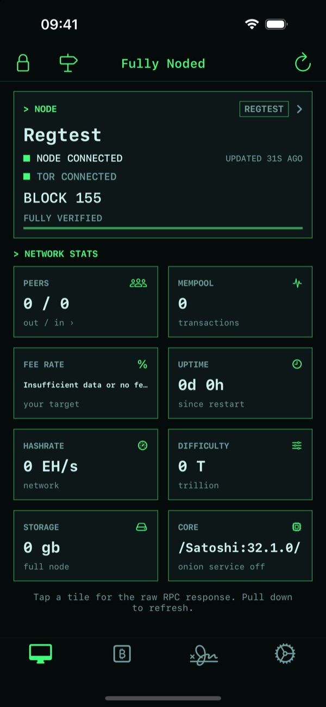
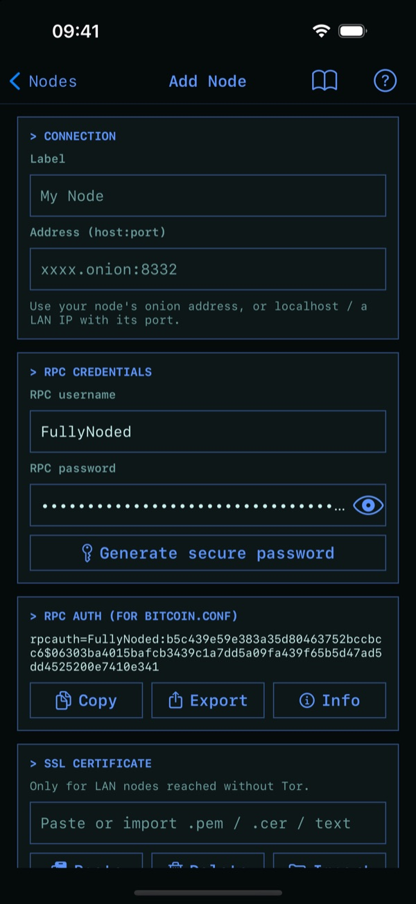
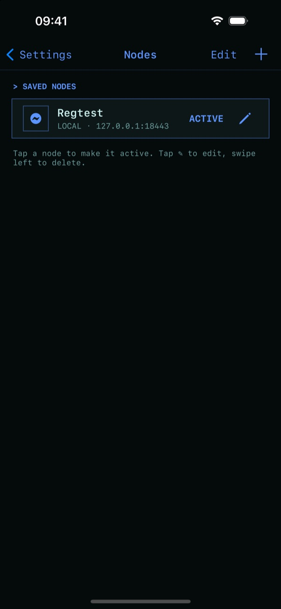

# Connect your node

Fully Noded needs a Bitcoin Core (or Knots) node. Pick one way to reach it:

| Way | Best for |
|---|---|
| [Fully Noded Server](#fully-noded-server-easiest) | A Mac. It installs and configures everything for you. |
| [Nostr Connect](#nostr-connect-fastest) | Fast remote access (about a second) via Fully Noded Server. |
| [Tor](#tor-any-node) | Any node, from anywhere, private. |
| [Local network](#local-network) | Your node is on the same Wi-Fi or VPN (e.g. Tailscale). |

Once connected, the home screen shows your node:

Tap any tile to see the raw RPC response behind it.

## Fully Noded Server (easiest)

[Fully Noded Server](https://github.com/Fonta1n3/FullyNoded-Server) installs Bitcoin Core or Knots
and Tor on your Mac. On the node's page, open **Quick Connect** to show a QR.

1. In Fully Noded: **Settings → Node Manager → + → Scan QR**.
2. Scan the QR from Fully Noded Server.

## Nostr Connect (fastest)

In Fully Noded Server open **Nostr Connect → Pair Fully Noded**, then scan its QR the same way
(**Settings → Node Manager → + → Scan QR**). Details: [Nostr-Connect.md](../Nostr-Connect.md).

## Tor (any node)

1. Set up a Tor hidden service for your node's RPC port: [Tor setup](../Tor/Tor.md).
2. Add the node manually (below) with the onion address, e.g. `abc…xyz.onion:8332`.

Many node packages (Umbrel, Start9, myNode, RaspiBlitz, BTCPay Server) show a Fully Noded
or "BTC RPC" QR code that does this for you: scan it with **Node Manager → + → Scan QR**.

## Local network

Add the node manually with its local address, e.g. `192.168.1.20:8332` or `127.0.0.1:8332`.
If your node's RPC uses TLS, paste or import its certificate in **SSL certificate**.

## Adding a node manually

**Settings → Node Manager → + → Manually**

1. **Label**: any name.
2. **Address**: `host:port`. The RPC port is `8332` on mainnet, `18332` on testnet3, `48332` on testnet4,
   `38332` on signet and `18443` on regtest.
3. **RPC credentials**: Fully Noded creates a username and a strong password for you.
4. **RPC auth**: tap **Copy** or **Export** and add that `rpcauth=…` line to your node's
   [bitcoin.conf](./bitcoin-conf.md), then restart your node. (Using your own `rpcuser` and
   `rpcpassword` also works: type them in instead.)
5. Tap **Save Node**.

The node becomes active and the home screen loads. You can save several nodes and switch between
them in the Node Manager:

Can't connect? See [Troubleshooting](../Troubleshooting.md).
