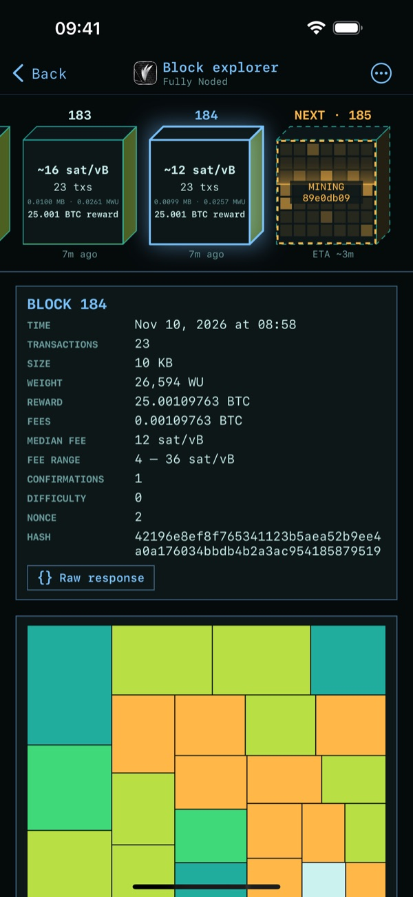
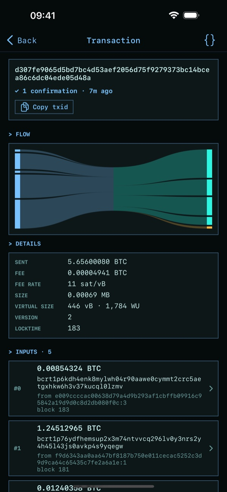
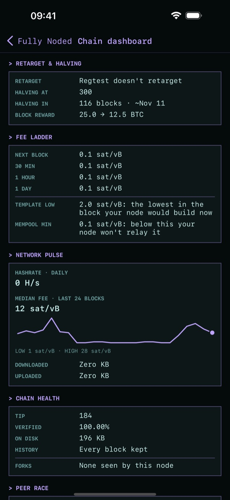

# Block explorer

Every block and transaction, read from your own node. Nothing you look at goes to anyone else's
server. Open it from **Block explorer** on the home screen.

## Blocks

Blocks run left to right, oldest to newest, with the next block being mined at the right end.
Swipe the strip, or swipe the details below it. Each block shows its height, age, size, median fee,
reward and who mined it, and a new one drops in by itself with a small celebration. There's a bigger
one if the block's coinbase says a solo miner won it. That's self-reported, like every miner tag.

Tap **⋯** for:

- **Your coins**: the blocks holding the active wallet's coins. Tap a block to go there, or a coin
  to trace it.
- **Go to block height**
- **Chain dashboard**
- **Famous blocks and coins**

On a pruned node, older blocks only have their header left, and they're marked **PRUNED**. Fiat amounts
use today's exchange rate, even on old blocks.

## The block map

Every transaction in a block at once: area is its size, colour is its fee rate. Tap one to open it.
It's many megabytes, so over Tor it loads when you ask.

## Transactions

- **Flow**: inputs on the left, outputs on the right, each ribbon as wide as its share of the value.
  The amber ribbon is the fee. Tap a ribbon to go to that input or output.
- **What it looks like**: CoinJoin, consolidation, batch payment, no change, data or spam, old coins,
  or a famous or stolen address. These are guesses from public data, not facts.
- **Embedded data**: tap **Decode** to read OP_RETURN text and protocols (Runes, Omni, Counterparty,
  Stacks and others), inscriptions, and data hidden in bare multisig. A name means the bytes match that
  format, not that a token is valid under its own rules.
- **Follow the coins**: tap an input to go back to where it came from, and an output to see if
  it's been spent. Bitcoin Core keeps no index of spends, so one spent in a block can't be followed
  forward from here. [Fully Noded Server](https://github.com/Fonta1n3/FullyNoded-Server) can find it.

## Famous blocks and coins

Satoshi's coins, the genesis address, the Mt. Gox theft and more, plus landmark blocks. Tap a coin to
check its balance against your node's own UTXO set: it takes about a minute and works on a pruned node.
The genesis address has so many tiny coins that it's only offered off Tor. These are mainnet only.

## Chain dashboard

- **Difficulty and halving**: how far through the period, the projected change, and when the next
  halving should be.
- **Fee ladder**: your node's estimates, and the lowest fee in the block it would build now.
- **Network pulse**: hashrate, recent fees, and how much your node has downloaded and uploaded.
- **Chain health**: how much is verified, disk use, how far back you've pruned, and any forks your
  node has seen.
- **Peer race**: which peers brought your node a block most recently.
