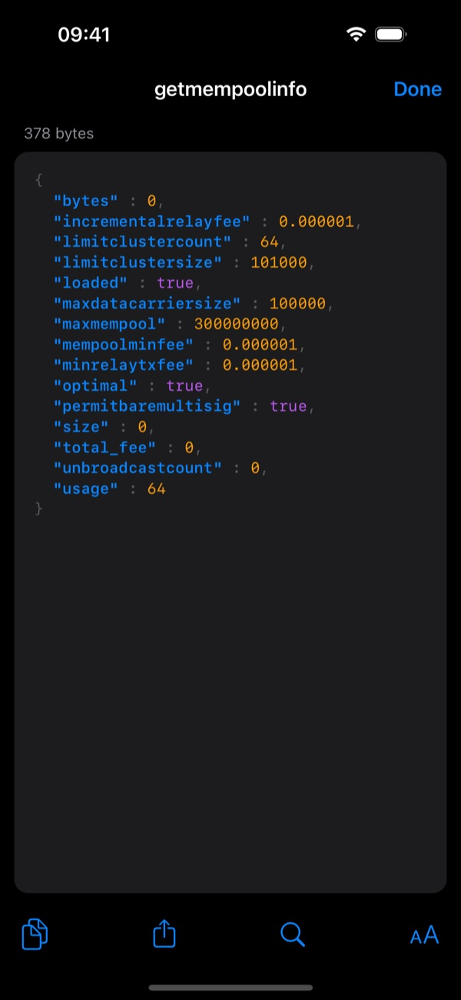

# How does it work?

Bitcoin Core can do far more than its own app shows: almost everything is behind its RPC
interface (`bitcoin-cli`). Fully Noded is a phone interface to that RPC, plus an offline signer.

```
iPhone (Fully Noded)                          Your computer
┌─────────────────────┐   Tor / Nostr / LAN   ┌──────────────┐
│ seed words (signer) │ ────── RPC ─────────▶ │ Bitcoin Core │
│ signs PSBTs offline │ ◀──── results ─────── │ watch-only   │
└─────────────────────┘                       └──────────────┘
```

**Connecting.** Fully Noded sends JSON-RPC requests to your node, authenticated with your RPC
username and password, over one of:

- **Tor**: to your node's onion address, from anywhere. Tor runs inside Fully Noded.
- **Nostr Connect**: end-to-end encrypted through a relay to Fully Noded Server
  ([details](./Nostr-Connect.md)).
- **Your local network** or a VPN.

**Wallets.** When you create a wallet, Fully Noded makes the seed words and keeps them. It gives
your node only the public keys (descriptors), so your node's wallet is watch-only. Your node finds
your coins, tracks your balance and builds unsigned transactions (PSBTs).

**Signing.** Fully Noded signs the PSBT on your phone with the seed, then your node checks and
broadcasts it. Private keys never leave the phone.

Every call is a normal Bitcoin Core command. For example, the home screen uses
`getblockchaininfo`, `getnetworkinfo`, `getpeerinfo` and `getmempoolinfo`. Tap a tile to see the
raw response:



Anything Fully Noded does, you could do with `bitcoin-cli`. Fully Noded just makes it a tap.
