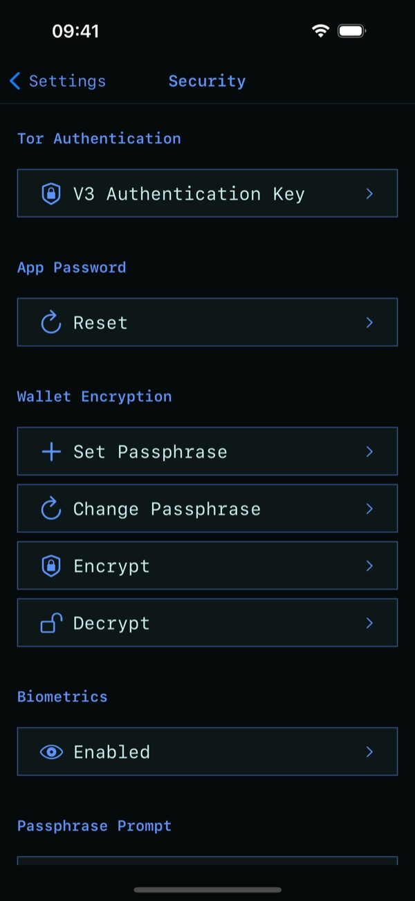

# Security: best practices

Fully Noded keeps your seed words encrypted on your phone and only talks to your own node. These
settings make it harder for anyone holding your phone to get in.

**Settings → Security Center**

| Setting | What it does | Recommended |
|---|---|---|
| **App Password** | Locks the app. Wrong guesses lock you out for longer each time, even across reinstalls. | On, with a long password |
| **Biometrics** | Unlock with Face ID / Touch ID instead of the password. | Off if someone could force your face or finger |
| **Duress Pin** | Entering it at the lock screen wipes Fully Noded's data and opens an empty app. | Set one if you may be coerced. Your seed words must be backed up. |
| **Passphrase Prompt** | Asks for your BIP39 passphrase every time you sign instead of storing it. | On if your seeds use passphrases |
| **Tor Authentication** | Only your phone can reach your node's onion address. See [Tor authentication](./Tor/Authentication.md). | On for Tor connections |
| **Wallet Encryption** | Encrypts the active wallet on your node with a passphrase (`encryptwallet`). Only matters if your node's wallet has private keys; Fully Noded wallets don't. | Optional |

Forgot the app password? **Forgot password? Reset app** on the lock screen wipes the app so you can start over. You'll
need your seed words and backups.

Also:

- Read [Backups and recovery: best practices](./Backup-Recovery-Best-Practices.md).
- Use your own node over Tor or [Nostr Connect](./Nostr-Connect.md). Don't expose your node's RPC
  port to the internet.
- Check every transaction in the verifier before you sign: amount, recipient, change and fee.
