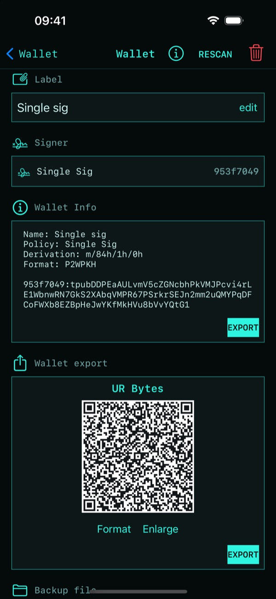

# Back up a wallet

A wallet needs two things to be fully recovered:

1. **The seed words**: they spend. Write them down on paper or metal when you create the wallet.
2. **The wallet's public keys (descriptors)**: they find your coins. For a single-sig wallet the
   seed words alone are enough, since Fully Noded derives the same descriptors from them. A
   multisig or timelocked wallet also needs its descriptors.

## Exporting the descriptors

Open the wallet tab → ⓘ:

- **Wallet export**: a QR code (UR or JSON) with the wallet's descriptors. Scan it to import the
  wallet into Fully Noded or another wallet. **Format** switches the encoding, **Enlarge** shows it
  full screen.
- **Backup file**: all of the wallet's descriptors as read from your node, including any timelocks.
  This is the most complete backup. Recover it with **+ → Paste text** or **Open a file**.

Neither contains private keys, but both reveal your whole balance and history to anyone who sees
them. Keep them private.

Learn more about keeping seeds safe:
[The Smart Custody Book](https://github.com/BlockchainCommons/SmartCustodyBook).
