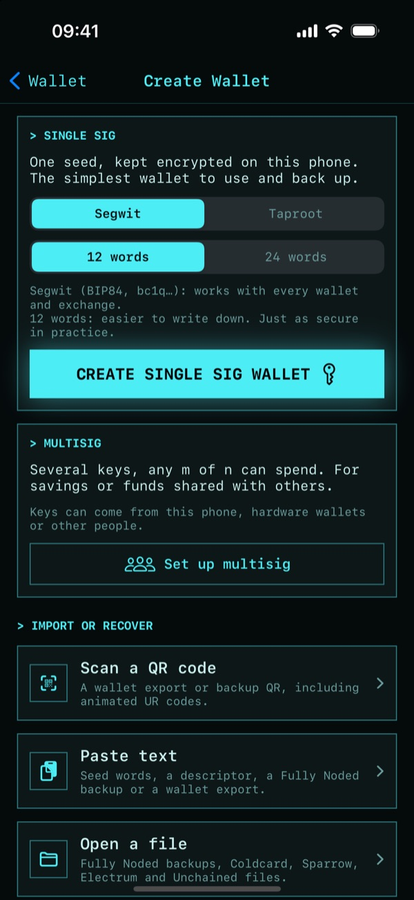
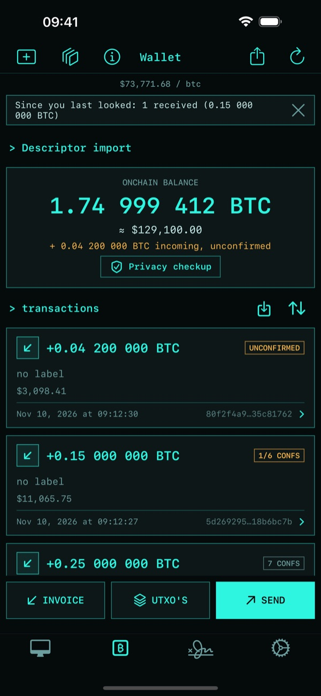
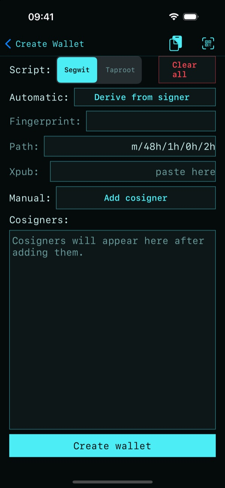
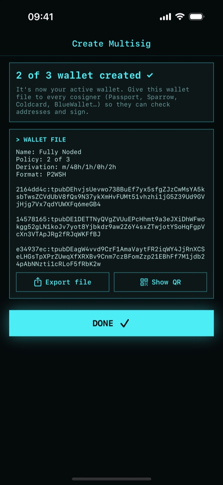

# Create a wallet

A Fully Noded wallet is split in two:

- **Your node** holds the public keys (descriptors) as a watch-only wallet. It finds your coins,
  shows balances and builds transactions.
- **Fully Noded** holds the seed words as a [signer](./Signers.md), encrypted on your phone. It
  signs transactions. Your node never sees a private key.

Open the **wallet tab** (₿) and tap **+**:

## Single-sig

1. In the **Single sig** card pick **Segwit** (works everywhere) or **Taproot** (cheaper, more
   private spends), and **12** or **24 words**.
2. Tap **Create single sig wallet**. Fully Noded makes the seed words and creates the wallet on
   your node.
3. **Write the words down** on paper, then tap **I saved them**. They are the only way to recover
   your bitcoin. See [Backups](./Backup-Wallets.md).

The new wallet is active right away:

From here: [Invoice](./Receiving.md) to receive, [Send](./Sending.md) to pay, **UTXOs** for coin
control.

## Multi-sig

**Set up multisig** opens the multisig creator:

1. **Script**: **Segwit** works with almost every hardware wallet; **Taproot** gives smaller,
   more private spends but every cosigner must support it. Keep the default path unless your
   devices use another (**Edit**).
2. **Cosigners**: add one key per cosigner.
   - **This phone**: derive it from one of your signers.
   - **New key**: make a new 12 word signer. Write the words down when they're shown.
   - **Scan** or **Paste** a hardware wallet's multisig export, an xpub or a descriptor.
   - **Type** a fingerprint and xpub.

   Remove a key with ⓧ. The same key can't be added twice.
3. **Signatures required**: **−** / **+**. It starts at a majority (2 of 3, 3 of 5) and warns
   you about 1 of n (any single key can spend) and n of n (lose one key and the funds are stuck).
4. Tap **Create**. Then **Export file** or **Show QR** and give the wallet file to every
   cosigner. A multisig can't be recovered without every cosigner's xpub, so this backup
   matters as much as the seeds.

## Import

| Option | For |
|---|---|
| **Scan a QR code** | A wallet export or backup QR (UR or JSON), e.g. from Specter or another Fully Noded |
| **Paste text** | Seed words, a descriptor, a Fully Noded backup or a wallet export |
| **Open a file** | Fully Noded backups, Coldcard (single and multisig), Sparrow, Electrum multisig and Unchained files |
| **Bitcoin Core wallets** | Use a wallet that already exists on your node |

Importing seed words also adds them as a signer, so the wallet can spend. Importing public
keys only gives a watch-only wallet: sign elsewhere, or add the seed as a signer later.

## Switching wallets

Tap the icon next to **+** on the wallet tab to switch wallets. All your wallets are also
listed in **Settings → Saved Wallets**.
