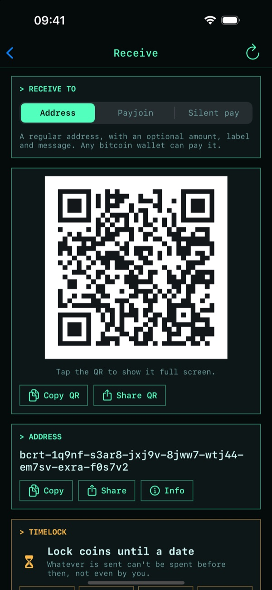
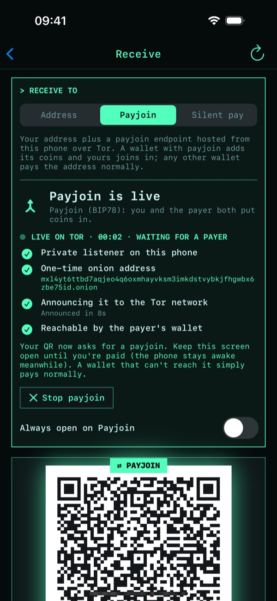
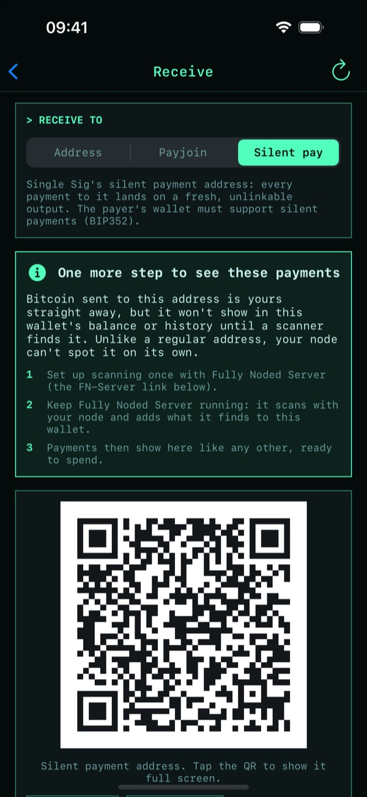

# Receive

On the wallet tab tap **Invoice**. Pick what to receive to:

| Option | What the payer gets |
|---|---|
| **Address** | A new address from your node. Any wallet can pay it. |
| **Payjoin** | The address plus a payjoin endpoint hosted from your phone over Tor. |
| **Silent pay** | Your reusable silent payment (`sp1…`) address. |

Tap the QR to show it full screen, or use **Copy** / **Share**. The refresh button (top right)
gets a new address.

## Address

Under **Request** you can add an amount, label and message. They're added to the payment request
(BIP21), so the payer's wallet fills them in.

## Payjoin

Fully Noded starts a one-time onion address on your phone and adds it to the QR. A wallet that
supports payjoin (BIP78) adds one of your coins to the payment, which breaks the "all inputs are
the payer's" assumption chain analysis relies on. Any other wallet just pays the address.

Keep the screen open until you're paid. More: [Payjoin.md](../Payjoin.md).

## Silent payments

One address you can post anywhere, yet every payment lands on a new, unlinkable output. Your node
can't spot these payments on its own: set up scanning once with Fully Noded Server (tap
**FN-Server link** on this screen) and keep it running. Payments then show in this wallet like any
other. More: [SilentPayments.md](../../SilentPayments.md).

## Timelock

Under **Timelock** on the Address screen you can lock coins until a date (1 month to 4 years, or
any date). The address shown is replaced by a timelocked one, and whatever is sent to it can't be
spent before that date, not even by you. The timelock is added to your wallet backup: export a
fresh one when asked.
