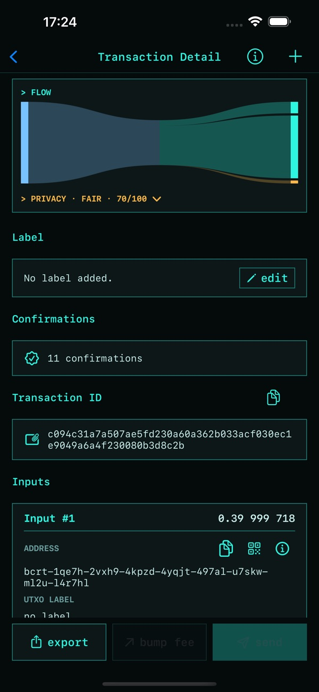

# Send

Sending has three steps: **create** the transaction, **check and sign** it, **broadcast** it.

## 1. Create

On the wallet tab tap **Send**:

- **Amount**: in BTC. **MAX** sends everything (sweeps the wallet).
- **Recipient**: **Paste** an address or payment request, or scan one with the QR button (top
  right). Silent payment (`sp1…`) addresses and payjoin invoices (`pj=`) work here too.
  - **Wallet**: send to another of your wallets.
  - **Batch**: add this recipient to a list and enter the next one, to pay several in one
    transaction.
  - **Donate**: fills in a donation address for Fully Noded development. Thank you!
- **Fee**: your node's estimate, or type a fee rate in sat/vB.

Tap **Create transaction**. Your node builds a PSBT (an unsigned transaction) from your coins.

**Coin control**: to choose which coins to spend, open **UTXOs** on the wallet tab and tap
**Spend** on a coin (or **Select** several). **Lock** keeps a coin from being spent.

## 2. Check and sign

The transaction verifier shows every input and output: amount, address, whether it's yours, your
change, and the fee.

Tap **Sign**. Fully Noded signs with the matching signer on your phone, then your node checks the
transaction would be accepted (**Mempool accept**).

If the keys aren't on this phone (a hardware wallet, or a multisig cosigner), tap **Export** to
pass the PSBT on as a file, text or QR code. Open the signed PSBT in Fully Noded again (scan it,
paste it or open the file) to finish.

Tap ⓘ (top right) for the raw `decodepsbt` output from your node.

## 3. Broadcast

Check the **Mining fee**, then tap **Send** and choose:

- **Via my node**, or
- **Via Esplora (Tor)**: mempool.space's onion service, or your own (Settings ▸ Esplora). More
  private, since your node doesn't announce your own transaction first.

## Read it before you sign

The top of the verifier shows:

- **Flow**: where the money goes. The amber ribbon is the fee. Tap a ribbon to go to that input or
  output.
- **Self transfer**: when every output comes back to this wallet, so only the fee leaves it.
- **Next step**: for a PSBT, what it still needs and how many signatures are missing.
- **Privacy**: a grade from common chain-analysis assumptions, such as spending several addresses
  together or a change output that can be told apart. Tap it for the reasons. A good grade doesn't make
  a transaction private, and how you broadcast it matters too.

An input with no **Sign** button is one no signer on this device can sign.

## Will it confirm?

Tap an unconfirmed transaction to see its effective fee rate, counting any unconfirmed parents and
children, and how that compares with your node's estimates and the block it would build now. On
Core 32 or later it uses the rate miners actually work from (its chunk rate).

If your node no longer has it in its mempool, it may never confirm unless it's broadcast again. If
it's your wallet's, you can **Abandon** it, so the wallet stops counting it and can spend its coins
again. That doesn't cancel it: another node may still have it, and it can still confirm unless you
spend those coins in a new transaction first.

## Bump the fee (RBF)

Stuck transaction? Tap it on the wallet tab, tap **Bump fee**, then **Send** again. The new
transaction replaces the old one.

You need a coin to pay the higher fee with, so bumping doesn't work after sending everything
(**MAX**). Use a higher fee when you sweep a wallet.
