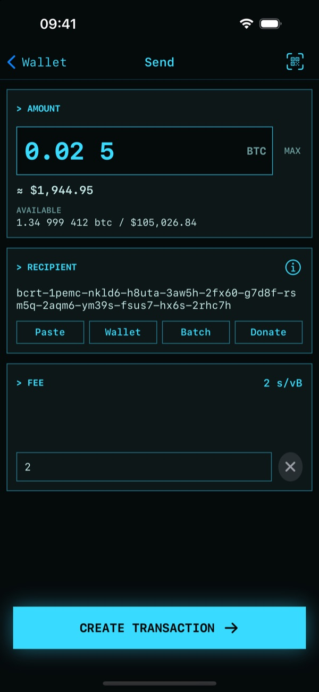
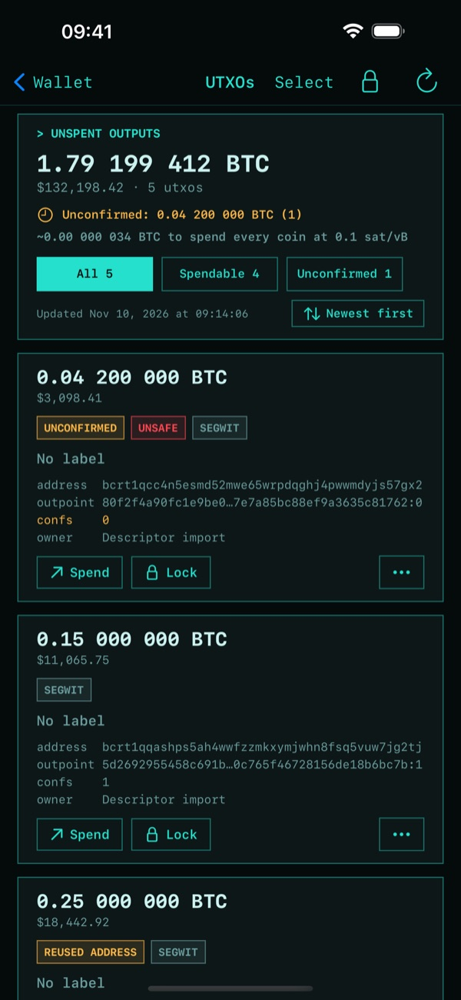
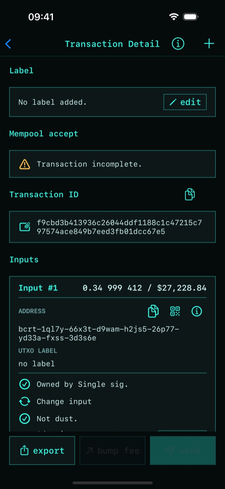
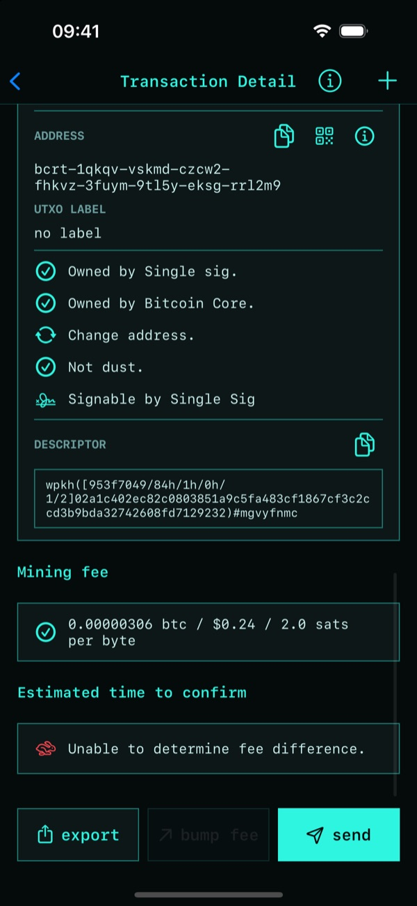
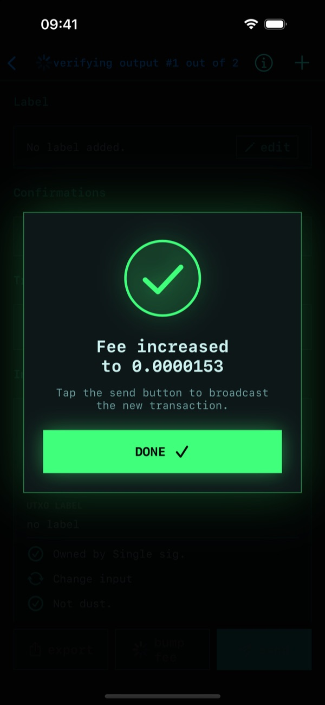

# Send

Sending has three steps: **create** the transaction, **check and sign** it, **broadcast** it.

## 1. Create

On the wallet tab tap **Send**:

- **Amount**: in BTC. **MAX** sends everything (sweeps the wallet).
- **Recipient**: **Paste** an address or payment request, or scan one with the QR button (top
  right). Silent payment (`sp1…`) addresses and payjoin invoices (`pj=`) work here too.
  - **Wallet**: send to another of your wallets.
  - **Batch**: add this recipient to a list and enter the next one, to pay several in one
    transaction.
  - **Donate**: fills in a donation address for Fully Noded development. Thank you!
- **Fee**: your node's estimate, or type a fee rate in sat/vB.

Tap **Create transaction**. Your node builds a PSBT (an unsigned transaction) from your coins.

**Coin control**: to choose which coins to spend, open **UTXOs** on the wallet tab and tap
**Spend** on a coin (or **Select** several). **Lock** keeps a coin from being spent.

## 2. Check and sign

The transaction verifier shows every input and output: amount, address, whether it's yours, your
change, and the fee.

Tap **Sign**. Fully Noded signs with the matching signer on your phone, then your node checks the
transaction would be accepted (**Mempool accept**).

If the keys aren't on this phone (a hardware wallet, or a multisig cosigner), tap **Export** to
pass the PSBT on as a file, text or QR code. Open the signed PSBT in Fully Noded again (scan it,
paste it or open the file) to finish.

Tap ⓘ (top right) for the raw `decodepsbt` output from your node.

## 3. Broadcast

Check the **Mining fee**, then tap **Send** and choose:

- **Via my node**, or
- **Via Esplora (Tor)**: Blockstream's server over Tor. More private, since your node doesn't
  announce your own transaction first.

## Bump the fee (RBF)

Stuck transaction? Tap it on the wallet tab, tap **Bump fee**, then **Send** again. The new
transaction replaces the old one.

You need a coin to pay the higher fee with, so bumping doesn't work after sending everything
(**MAX**). Use a higher fee when you sweep a wallet.
