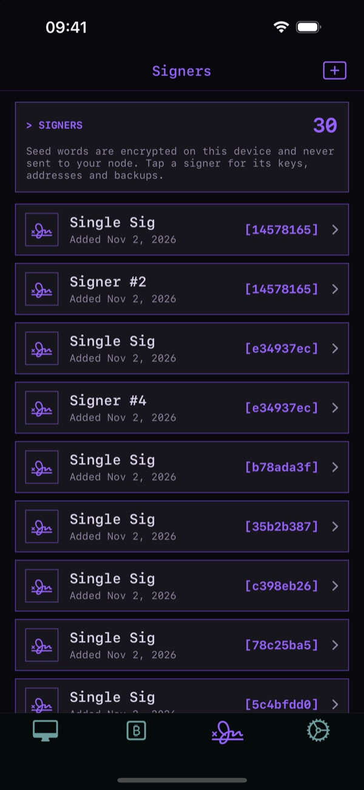

# Signers

A signer is a set of BIP39 seed words (and optional passphrase) stored on your phone. Signers are
what make your wallets spendable: your node only ever has public keys.

- **Stored encrypted** on this device, with a key kept in the keychain. Never sent to your node
  and never synced to iCloud.
- **Signing happens offline**, on the phone. When you tap **Sign** on a transaction, Fully Noded
  tries every signer that can sign it.
- **Add one**: Signers tab → **+**. Create new words, or type or paste yours (it checks the last
  word's checksum).
- **Tap a signer** for its fingerprint, xpubs for each script type, addresses, its silent payment
  address and backup options.
- **Delete the words** to make a wallet watch-only. You can add them back later and it can spend
  again.

## Passphrases

If your seed has a BIP39 passphrase, add it with the words. Prefer not to store it? Turn on
**Settings → Security Center → Passphrase Prompt** and Fully Noded asks for it each time it signs.

## Signing for other wallets

A signer can sign for any wallet whose keys it holds, including PSBTs from other software. Open,
paste or scan a PSBT in Fully Noded and tap **Sign**.
