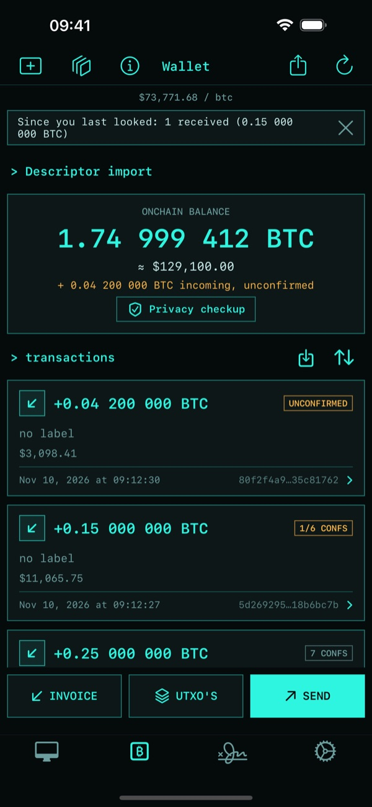
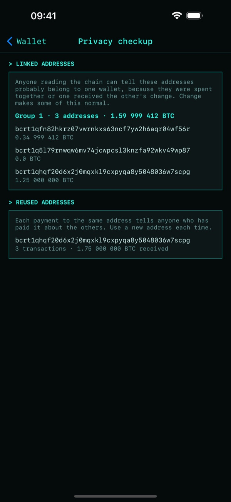

# Understanding your wallet

Your node knows more about your wallet than a balance. These read it for you, and only ever read.

## What the balance leaves out

Under the balance you'll see anything it doesn't include: unconfirmed payments on their way to you and
mining rewards still maturing.

## Since you last looked

A banner lists what confirmed since you last opened this wallet: what you received, what you
sent, and anything a reorg dropped from the chain. Tap **×** to dismiss it.

## Privacy checkup

Tap **Privacy checkup** under the balance. It's the same whatever it would find, so tapping it doesn't
mean anything's wrong.

- **Linked addresses**: addresses anyone can tell probably belong to one wallet, because they were
  spent together or one received the other's change. Change makes some of this normal.
- **Reused addresses**: addresses that received more than once, which tells anyone who paid one
  about the others. Use a new address each time.

Tap an address to copy it.

## Coins not worth spending

On the UTXO screen, a coin that would cost 10% or more of its value to spend at your node's one hour
fee estimate gets a badge, and **WORTH LESS THAN ITS FEE** once spending it would lose money. The summary
shows what spending every coin would cost.

## Seeing where your coins came from

[The block explorer](../Block-Explorer.md)'s **Your coins** takes you to the blocks holding them.
